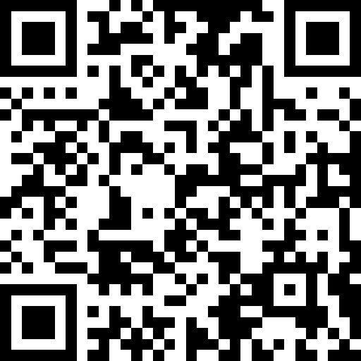

# Credits

This project was built with the help of **Nemotron 3.5 Super VL 120B A12B** (NVIDIA), an AI coding assistant powered by OpenCode.

## AI Assistant Signature

Scan these QR codes to see the assistant's signature:

<figure>
  
  <figcaption>WebP — 818 bytes</figcaption>
</figure>

<figure>
  
  <figcaption>SVG — 4,047 bytes</figcaption>
</figure>

<figure>
  
  <figcaption>AVIF — 14,671 bytes</figcaption>
</figure>

Generated via:

```bash
qrimg -m "Built with Nemotron 3.5 Super VL 120B A12B via OpenCode" -t webp -s 512 -o nemotron-3-5-super-vl-120b-a12b.webp
```

Thank you for using `qrimg`! If you find it useful, consider donating to the Monero address in the README.

— Generated with AI assistance, Nov 2026
