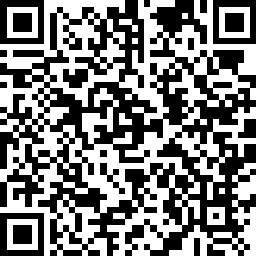
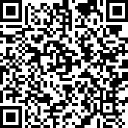
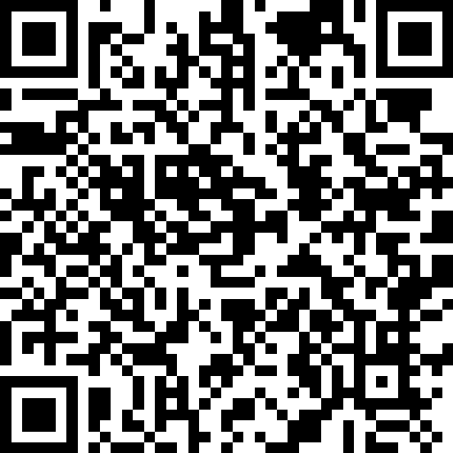

# qrimg

Generate QR code images (`.webp`, `.svg`, `.avif`) from text on the command line.

Pure Rust CLI tool — no C compiler or system libraries needed at runtime.

## Install

```bash
# From crates.io (once published)
cargo install qrimg

# Or build from source
git clone https://github.com/nakatam1337/qrimg.git
cd qrimg
cargo install --path . --force
```

## Usage

```bash
# Read from stdin (Ctrl+D to create, Ctrl+C to cancel)
qrimg

# From message argument
qrimg -m "hello world"

# From a text file
qrimg -f notes.txt

# Custom output file and format
# The extension you give to `-o` is ignored — the format is decided by `-t` only.
qrimg -m "scan me" -t svg -o myqr     # writes myqr.svg
qrimg -m "scan me" -t avif -o myqr    # writes myqr.avif

# Custom size (square, one side only)
qrimg -m "small qr" -s 256 -t webp -o small # writes small.webp

# Error correction level
qrimg -m "important" -e H -t webp -o robust.webp

# Force overwrite without confirmation
qrimg -m "new" -t webp -o existing.webp -y
```

## Flags

| Flag | Default | Description |
|------|---------|-------------|
| `-m, --message` | — | Text to encode into a QR code |
| `-f, --file` | — | Read message from a text file |
| `-t, --type` | `webp` | Output format: `webp`, `svg`, or `avif` |
| `-o, --output` | timestamp + ext | Output **base name** — extension is decided by `-t/--type` only |
| `-s, --size` | `512` | Square image size in pixels (8–8192) |
| `-e, --ec-level` | `M` | Error correction: `L`, `M`, `Q`, `H` |
| `-y, --force` | — | Skip overwrite confirmation |
| `-h, --help` | — | Print help |
| `-V, --version` | — | Print version |

## Behavior

- **Input priority:** `-m` message > `-f` file > stdin (interactive prompt)
- **Extension:** decided by `-t/--type` only — any extension you add to `-o` is ignored
- **Default output name:** Unix timestamp + extension (e.g. `1794695770.webp`)
- **Edge-to-edge:** QR codes are rendered edge-to-edge with no quiet zone border (consistent across WebP, SVG, and AVIF). The quiet zone is planned as a future option (see Roadmap).
- **Overwrite:** if the output file exists and `-y` is not passed, you'll be prompted (interactive) or it will fail (non-interactive)
- **Input limit:** 2,000 bytes max — QR codes top out around 2,953 bytes, so larger input is rejected with a clear message

## Examples

This section uses the Monero payment address stored in `xmr.txt` (also included in this repo):

```text
monero:84UmH6cimhPMt24owNTJBtdBh2SQjZmDbQswMEZsQN7gDkX4Du9MdKYGnoMUgHW91jAcywZeCiXVgbq7Yz7PGWVTFtAuKbn
```

### Via `-f` file input (reads from `xmr.txt`)

**WebP**

```bash
qrimg -f xmr.txt -t webp -s 256 -o xmr-256
```



```bash
qrimg -f xmr.txt -t webp -s 512 -o xmr-512
```


```bash
qrimg -f xmr.txt -t webp -s 1024 -o xmr-1024
```


**SVG**

```bash
qrimg -f xmr.txt -t svg -s 256 -o xmr-256
```



```bash
qrimg -f xmr.txt -t svg -s 512 -o xmr-512
```


```bash
qrimg -f xmr.txt -t svg -s 1024 -o xmr-1024
```


**AVIF**

```bash
qrimg -f xmr.txt -t avif -s 256 -o xmr-256
```


```bash
qrimg -f xmr.txt -t avif -s 512 -o xmr-512
```


```bash
qrimg -f xmr.txt -t avif -s 1024 -o xmr-1024
```


### Via `-m` message argument

```bash
qrimg -m "$(cat xmr.txt)" -t webp -s 512 -o xmr-message
```


### Via stdin

```bash
cat xmr.txt | qrimg -t webp -s 512 -o xmr-stdin
```



### More options

```bash
# High error correction (more damage-tolerant)
qrimg -f xmr.txt -e H -t svg -s 512 -o xmr-high-ec
```


```bash
# Skip overwrite confirmation
qrimg -f xmr.txt -t webp -s 512 -o xmr-512 -y
```

### More examples

```bash
# Encode a URL as SVG
qrimg -m "url:https://example.com" -t svg -o link
```


```bash
# Encode the Monero address directly via -m
qrimg -m "monero:84UmH6cimhPMt24owNTJBtdBh2SQjZmDbQswMEZsQN7gDkX4Du9MdKYGnoMUgHW91jAcywZeCiXVgbq7Yz7PGWVTFtAuKbn" -t webp -o xmr-direct
```


```bash
# Encode file contents as AVIF
qrimg -f secret.txt -t avif -o secret
```

```bash
# Small QR code for printing
qrimg -m "WiFi password" -s 256 -t webp -o wifi
```

```bash
# High error correction (scannable even if damaged)
qrimg -m "fragile data" -e H -t svg -o robust
```

### Interactive prompt (no arguments)

Just run `qrimg` with no arguments — it prints an emoji prompt to stderr and waits for you to type text (Ctrl+D to create, Ctrl+C to cancel):

```bash
qrimg
# 🔲 Enter text (Ctrl+D to create, Ctrl+C to cancel):
# > monero:84UmH6cimhPMt24owNTJBtdBh2SQjZmDbQswMEZsQN7gDkX4Du9MdKYGnoMUgHW91jAcywZeCiXVgbq7Yz7PGWVTFtAuKbn
# ^D
# ✅ 1794695770.webp  (422 bytes, 512×512)
```

A spinner shows while the QR code is being generated, then the file is written to disk.

## Donate

If you find `qrimg` useful, you can donate to the Monero address below:

```
monero:84UmH6cimhPMt24owNTJBtdBh2SQjZmDbQswMEZsQN7gDkX4Du9MdKYGnoMUgHW91jAcywZeCiXVgbq7Yz7PGWVTFtAuKbn
```

Thank you! 🙏💖💸 Every monero helps keep this project going! ✨🚀💫

## License

This tool is dedicated to the public domain under **CC0-1.0**. See `LICENSE` for details.

## Roadmap

See [`ROADMAP.md`](ROADMAP.md) for planned features (quiet zone, custom colors, center logo, batch mode).
